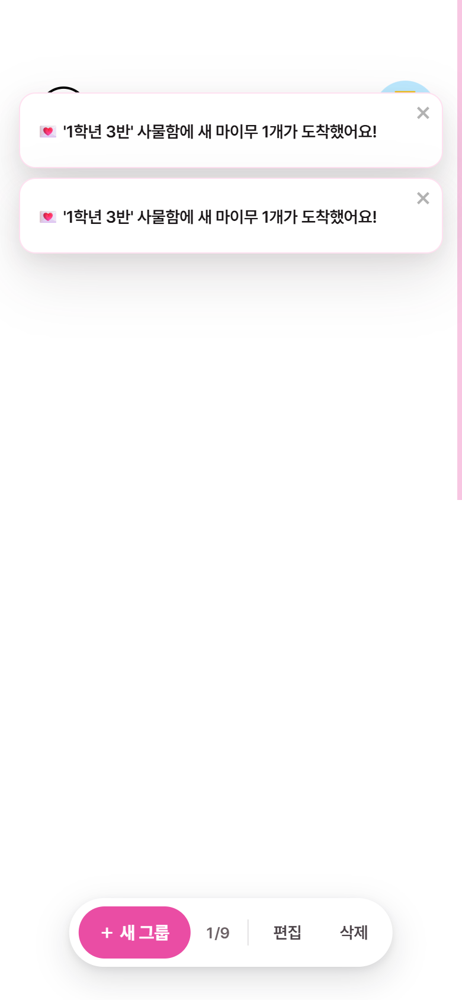

# MAIMU 성능 고도화 보고서 — 실시간 알림(SSE) · Redis Write-back / Cache-aside · k6 부하테스트

> 새 학기 첫인상 공유 서비스 **MAIMU**의 백엔드(Spring Boot 3.2 / Java 17 / MySQL 8 / Redis 7)를
> "한 사람의 초대 링크가 단톡방에 뿌려져 수백 명이 동시에 쪽지를 쓰는" 상황에 맞춰 고도화하고,
> 개선 효과를 단계별로 측정한 기록이다. 모든 수치는 같은 장비·같은 시나리오에서 직접 측정한 값이다.

---

## 0. 한눈에 보기

| 지표 (같은 환경, 같은 부하) | Before (v0) | After (v2) | 변화 |
| --- | ---: | ---: | ---: |
| 인기 사물함 1곳에 몰린 쪽지 작성 **최대 TPS** | 63.9 | **9,251** | **×145** |
| 위 상황의 **p99 응답시간** (동시 사용자 100명) | 3,445 ms | **24.2 ms** | **−99.3%** |
| 초대 링크 열기(게스트 조회) **최대 TPS** | 135 | **14,925** | **×110** |
| 초대 링크 열기 **p99** (초당 100건 고정 부하) | 753 ms | **45.3 ms** | **−94%** |
| 쪽지 작성 **p99.9** (초당 60건 고정 부하) | 118 ms | **28.5 ms** | **−76%** |
| 새 쪽지 → 접속 중인 주인 화면 알림 | 없음 (최대 1시간 뒤 메일) | **p50 156 ms / p99 261 ms** | 실시간화 |
| 데이터 유실 (30초간 387,869건 접수) | — | **0건** | 접수 = DB 반영 |

- **v0** 원본 → **v1** 불필요한 락·전체 로딩 제거(쿼리 개선만) → **v2** Redis Write-back + Cache-aside + SSE
- 단계를 나눠 잰 이유: "Redis 덕분"인지 "원래 코드가 비효율적이었던 것"인지를 **분리해서 설명**하기 위해서다.

---

## 1. 문제 정의 — 어디가 왜 느렸나

### 1-1. 쓰기: 같은 사물함에 쓰는 요청이 전부 한 줄로 섰다

게스트 쪽지 작성(`POST /v1/api/guest/{groupId}/{token}/add`)의 기존 흐름:

```
요청 → [트랜잭션 시작]
     → SELECT ... FROM lockers WHERE group_id=? FOR UPDATE   ← 사물함 행에 배타 락
     → INSERT INTO maimus ...                                 ← FK 검사로 부모 행에 공유 락
     → COMMIT (redo log fsync)
```

- 쪽지(자식 행)를 넣는 데 사물함(부모 행)을 **배타 락**으로 잡을 이유가 없다. FK가 이미 존재를 보장한다.
- 그런데 이 락 때문에 **같은 사물함으로 향하는 모든 쓰기가 직렬화**된다.
  시즌성 서비스 특성상 트래픽은 "인기 있는 한 사람의 사물함"에 몰린다.
- 측정으로 확인: 같은 코드에서 **50개 사물함에 분산하면 461 TPS, 1개에 몰면 63.9 TPS** (7배 차이) → 락 경합이 병목.

### 1-2. 읽기: 링크를 여는 읽기 요청이 락을 잡고 쪽지를 전부 읽었다

초대 링크 조회(`GET /v1/api/guest/invitation/{token}`)는 화면에 "쪽지 N개"만 보여주는데,

- 읽기 요청인데도 `SELECT ... FOR UPDATE`로 **사물함에 배타 락**을 걸었고,
- 개수를 구하려고 `group.getMaimus().size()` → **해당 사물함의 쪽지 전체(본문 TEXT 포함)를 메모리로 로딩**했다.
- 링크가 퍼지면 같은 사물함을 수백 명이 동시에 연다 → 읽기끼리도 직렬화되고, 쪽지가 많을수록 느려진다.

### 1-3. 알림: 새 쪽지는 최대 1시간 뒤 메일로만 알 수 있었다

기존 알림은 09–22시 매시 정각 메일 다이제스트뿐. 앱을 보고 있는 중에도 새로고침 전까지 알 수 없었다.

---

## 2. 해결

### 2-1. [v1] 불필요한 락·전체 로딩 제거

| 경로 | Before | After |
| --- | --- | --- |
| 쓰기 | `findByIdWithLock` (FOR UPDATE) + 컬렉션에 add | `getReferenceById` (쿼리 없음) + `save` |
| 읽기 | `findByIdWithLock` + `getMaimus().size()` (N행 로딩) | `findById` + `SELECT COUNT(*)` 1회 |

→ 인기 사물함 쓰기 **63.9 → 430 TPS**, 링크 조회 **135 → 894 TPS**.
그러나 여전히 요청마다 DB 트랜잭션(커밋·fsync)이 1번씩 있어 **DB 커넥션 풀(기본 10개)이 상한**이 된다.

### 2-2. [v2] Redis Write-back — 쓰기를 "접수"와 "반영"으로 분리

```
[요청 스레드]  초대 토큰 검증(Redis) → RPUSH maimu:write-buffer (JSON) → 201 응답   ※ DB 접근 0회
                                             │
[스케줄러 200ms]  LRANGE 0..999 ──→ 사물함·주인 일괄 조회(IN 쿼리 1회)
                                ──→ multi-row INSERT 1회 (트랜잭션)
                                ──→ LTRIM (커밋 성공 후에만 버퍼에서 제거)
                                ──→ 사물함 주인에게 SSE 알림 + 조회 캐시 무효화
```

핵심 설계 결정:

| 결정 | 이유 |
| --- | --- |
| **Redis List + LRANGE → INSERT → LTRIM** | DB 커밋이 성공한 뒤에만 버퍼에서 지운다 → **at-least-once**. 앱이 죽어도 Redis에 남은 건 다음 기동 때 반영된다. |
| **JdbcTemplate.batchUpdate + `rewriteBatchedStatements=true`** | JPA `IDENTITY` 전략은 Hibernate 배치 INSERT를 막는다. 드라이버가 1,000건을 **multi-row INSERT 한 문장**으로 합친다. |
| **작성 시각은 요청 시각으로 저장** | 버퍼에 머문 시간만큼 `created_at`이 밀리지 않게 한다. |
| **알림은 DB 반영 이후에 보낸다** | 알림을 누르고 들어갔는데 쪽지가 아직 없는 상황(read-your-writes 위반)을 막는다. |
| **불량 1건 격리(dead letter)** | 배치 중 1건이라도 제약을 어기면 전체가 롤백된다. 그 1건이 버퍼 전체를 막지 않도록 한 건씩 재시도하고 실패 건만 `maimu:write-buffer:dead`로 옮긴다. 요청 시점 길이 검증(`@Size`)으로 1차 차단. 측정 중 실제로 "플러시 도중 사물함이 삭제되는" 상황에서 FK 위반 32건이 격리되고 나머지는 정상 반영되는 것을 확인했다. |
| **Redis AOF (`appendfsync everysec`)** | 버퍼가 Redis에 있는 동안의 내구성. 최악의 경우 유실 범위를 1초로 제한. |

### 2-3. [v2] Redis Cache-aside — 링크 조회

- 키 `guest:group:{id}` → `{id, groupName, groupColor, maimuCount}` (TTL 60초)
- 조회: 캐시 히트면 DB 접근 0회, 미스면 DB에서 읽고 캐시에 적재.
- 무효화: 새 쪽지 DB 반영 시(플러시), 쪽지 삭제, 사물함 수정/삭제 시 `DEL`.
- **함정 하나를 구현 중 발견해 수정**: 서비스 클래스의 `@Transactional(readOnly = true)` 때문에
  **캐시 히트여도 트랜잭션이 시작되며 DB 커넥션을 잡는다.** 캐시 효과가 DB 커넥션 풀에 묶이는 구조라
  해당 서비스에서 클래스 레벨 트랜잭션을 제거했다(리포지토리 호출은 각자 트랜잭션을 가진다).

#### 캐시가 필요한 곳 / 필요 없는 곳 판단

| 엔드포인트 | 캐시 | 판단 근거 |
| --- | :---: | --- |
| `GET /guest/invitation/{token}` 링크 조회 | **적용** | 같은 키를 수백 명이 읽고(읽기 집중), 값은 쪽지가 쌓일 때만 바뀌며, 개수가 몇 초 늦어도 문제없다. |
| `GET /group/all` 내 사물함 목록 | 미적용 | 사용자 1명만 읽고, 쪽지가 올 때마다·읽을 때마다 안 읽은 개수가 바뀐다 → 적중률 낮고 무효화 비용만 든다. |
| `GET /maimu/{groupId}/all` 쪽지 목록 | 미적용 | 페이지·즐겨찾기·읽음 상태가 계속 바뀌는 개인 데이터. 인덱스 조회로 충분. |
| `GET /maimu/{id}` 쪽지 열기 | 불가 | 조회가 곧 쓰기(읽음 처리). |
| JWT 필터의 회원 존재 확인 | 후보 | 인증 요청마다 PK 조회 1회. 다음 개선 후보로 남김(탈퇴 시 무효화 필요). |

### 2-4. [v2] SSE 실시간 알림

- `GET /v1/api/notification/subscribe` (회원 전용, `text/event-stream`)
- 서버: 회원 id → 연결 집합(`ConcurrentHashMap<Long, Set<SseEmitter>>`). 탭 여러 개 지원.
  30초마다 heartbeat(프록시·로드밸런서 유휴 끊김 방지), 30분 타임아웃 후 클라이언트가 재연결.
- 프론트: `EventSource`는 `Authorization` 헤더를 실을 수 없어 **`fetch` 스트림을 직접 파싱**(의존성 추가 없음).
  토큰 만료(`T-003`)면 기존과 같은 방식으로 재발급 후 재연결. 페이지 토스트와 섞이지 않게 전용 `ToastContainer` 사용.
  토스트를 누르면 해당 사물함으로 이동하고, 사물함 화면은 안 읽은 개수를 즉시 다시 불러온다.
- 메일 다이제스트는 그대로 둔다 → **접속 중이면 SSE, 아니면 메일**로 역할이 나뉜다.



---

## 3. 부하테스트

### 3-1. 측정 방법

| 항목 | 내용 |
| --- | --- |
| 도구 | k6 v2.2.0 (`load-test/*.js`), 알림 지연은 Node 스크립트(`load-test/sse-latency.mjs`) |
| 처리량(TPS) | **closed model** — 동시 사용자(VU) 100명이 30초간 쉬지 않고 요청 |
| 지연(latency) | **open model (`constant-arrival-rate`)** — 응답이 느려져도 초당 N건을 계속 보낸다. 느린 응답이 다음 요청을 늦춰 지연이 과소 측정되는 **coordinated omission**을 피하기 위함 |
| 통계 | 평균 대신 **p50 / p95 / p99 / p99.9** |
| 공정성 | 매 측정 전 DB를 같은 상태로 재시드(회원 50, 사물함 50, 인기 사물함에 기존 쪽지 300개) + 10초 JIT 워밍업 |
| 환경 | 노트북 1대(Intel Core Ultra 9 285H 16코어, RAM 31GB, Windows 11)에서 k6 · 앱(JVM `-Xmx512m`) · MySQL 8.0.46 · Redis 7.4 (Docker) 동시 실행. MySQL 옵션은 운영과 동일(`innodb-buffer-pool-size=128M`, `max-connections=50`) |

### 3-2. 결과 — 쓰기 (게스트 쪽지 작성)

**최대 처리량 (VU 100, 30초)**

| 시나리오 | v0 원본 | v1 쿼리 개선 | v2 Write-back |
| --- | ---: | ---: | ---: |
| 인기 사물함 1곳에 집중 — TPS | 63.9 | 430.3 | **9,251.1** |
| 〃 p50 / p99 | 1,175 / 3,445 ms | 213 / 866 ms | **9.8 / 24.2 ms** |
| 50개 사물함에 분산 — TPS | 461.0 | 455.2 | **10,090.8** |
| 〃 p50 / p99 | 214 / 275 ms | 211 / 372 ms | **8.9 / 22.1 ms** |

**고정 부하 지연 (초당 60건, 인기 사물함, open model)**

| | p50 | p95 | p99 | p99.9 |
| --- | ---: | ---: | ---: | ---: |
| v0 | 22.2 ms | 33.3 ms | 63.0 ms | 118.1 ms |
| v1 | 24.5 ms | 68.6 ms | 85.8 ms | 122.0 ms |
| v2 | **5.1 ms** | **9.0 ms** | **16.0 ms** | **28.5 ms** |

> 해석: 저부하(초당 60건)에서는 경합이 거의 없어 v1의 락 제거만으로는 지연이 줄지 않는다(오차 범위 내 증가).
> 지연을 줄인 것은 **요청 경로에서 DB 커밋(fsync)을 빼낸 v2**다. 락 제거는 "처리량"에, write-back은 "처리량과 지연 둘 다"에 효과가 있었다.

**데이터 정합성 검증 (v2, 인기 사물함, VU 100, 30초)**

| 항목 | 값 |
| --- | ---: |
| 접수(201 응답) | 387,869건 (12,926 TPS) |
| DB 반영 | **387,869건 — 유실 0** |
| 부하 중 버퍼 최대 적체 | 7,482건 (≈ 0.6초 분량) |
| 부하 종료 후 버퍼가 비워지기까지 | 384 ms |

→ 접수 속도가 초당 1.2만 건이어도 DB 반영(multi-row INSERT)이 따라잡아 **버퍼가 계속 쌓이지 않는다**.

### 3-3. 결과 — 읽기 (초대 링크 열기, 인기 사물함)

| | v0 원본 | v1 쿼리 개선 | v2 Cache-aside |
| --- | ---: | ---: | ---: |
| 최대 TPS (VU 100) | 135.3 | 894.1 | **14,925.3** |
| 〃 p99 | 951 ms | 267 ms | **16.8 ms** |
| 고정 부하(초당 100건) p50 | 199.6 ms | 11.2 ms | **4.2 ms** |
| 〃 p99 | 753.4 ms | 183.0 ms | **45.3 ms** |
| 〃 p99.9 | 766.5 ms | 229.2 ms | **58.7 ms** |

### 3-4. 결과 — 실시간 알림 종단 지연 (v2)

"게스트가 작성 요청을 보낸 순간 → 사물함 주인의 SSE 연결에 이벤트가 도착한 순간" (300회 표본)

| 조건 | p50 | p90 | p95 | p99 | max |
| --- | ---: | ---: | ---: | ---: | ---: |
| 유휴 | 155.5 ms | 234.7 ms | 247.0 ms | 261.0 ms | 267.0 ms |
| 다른 사물함에 초당 2,000건 쓰기 부하 중 | 180.0 ms | 280.7 ms | 312.6 ms | 339.0 ms | 408.7 ms |

- 알림 지연의 대부분은 **플러시 주기(200ms)** 다. 쪽지가 DB에 들어간 뒤 알리기로 했기 때문에 생기는 의도된 비용이다.
- 같은 시간 배경 부하(초당 2,000건 작성) 자체의 응답은 p99 9.7 ms / p99.9 27.4 ms로 유지됐다.

### 3-5. 재현 방법

```bash
# 1) MySQL 8 / Redis 7 준비, 스키마 생성 후 시드
# 2) 앱 기동 (DB_URL 에 rewriteBatchedStatements=true 포함)
# 3) 사물함 초대 토큰을 load-test/tokens.json 에 [{groupId, token}] 형식으로 준비
cd load-test
MODE=throughput TARGET=hot    VUS=100  DURATION=30s NAME=write-hot  k6 run write-maimu.js
MODE=latency    TARGET=hot    RATE=60  DURATION=30s NAME=write-lat  k6 run write-maimu.js
MODE=throughput               VUS=100  DURATION=30s NAME=read       k6 run read-guest.js
ACCESS_TOKEN=<사물함 주인 토큰> SAMPLES=300 node sse-latency.mjs
# 결과 원본: load-test/results/*.json (k6 summary 전체)
```

---

## 4. 트레이드오프와 한계 (면접에서 먼저 말할 것)

| 항목 | 내용 | 대응 / 확장 방향 |
| --- | --- | --- |
| **TPS의 의미** | v2의 쓰기 TPS는 "접수" 기준이다. 대신 정합성 검증(3-2)으로 접수=반영을 확인했다. | 반영 지연(≤ 수백 ms)을 지표로 함께 본다. |
| **내구성** | 쪽지가 Redis에 머무는 동안 Redis가 죽으면 AOF `everysec` 기준 최대 1초 분량 유실 가능. | 금융 원장처럼 유실 0이 필수면 `appendfsync always` 또는 Kafka 같은 복제 로그 사용. |
| **전달 보장** | at-least-once. INSERT 커밋 직후 LTRIM 전에 죽으면 그 배치가 한 번 더 들어간다. | 멱등 키(요청 UUID + 유니크 제약)로 exactly-once 효과. |
| **일관성** | DB 반영까지 최대 ~200ms 동안 목록·개수에 안 보인다. 조회 캐시는 경합 시 최대 60초(TTL) 오차. | 쪽지 서비스 특성상 허용. 알림은 반영 후 발송해 사용자 체감 불일치는 없음. |
| **알림 지연 vs DB 효율** | 플러시 주기를 줄이면 알림은 빨라지지만 배치가 작아져 DB 효율이 떨어진다. | 버퍼 길이가 임계값을 넘으면 즉시 플러시하는 적응형 주기. |
| **수평 확장** | SSE 연결과 플러시 스케줄러가 단일 인스턴스 전제. | 알림은 Redis Pub/Sub 브로드캐스트, 플러시는 Redis 분산 락(`SET NX`)으로 리더 1대만. |
| **측정 환경** | 부하 발생기와 서버가 한 장비. 절대값보다 **같은 조건에서의 상대 비교**로 읽어야 한다. | 운영과 같은 EC2 + 별도 부하 발생기에서 3회 반복 측정 후 편차 보고. |

---

## 5. 저지연(low-latency)을 증명하는 방법 — 증권사 지원 관점

증권 시스템(주문 접수·시세 전송)은 평균이 아니라 **꼬리 지연(tail latency)** 과 **지연의 예측 가능성(jitter)** 으로 평가된다.
이 프로젝트에서 이미 적용한 것(✅)과 다음 단계로 할 것(➡️)을 정리한다.

### 5-1. 측정을 올바르게 한다

| | 방법 | 왜 중요한가 |
| --- | --- | --- |
| ✅ | **p99 / p99.9 보고**, 평균 사용 안 함 | 주문 1,000건 중 1건이 느려도 그 고객에겐 장애다. 평균은 꼬리를 숨긴다. |
| ✅ | **Open model(`constant-arrival-rate`)로 지연 측정** | Closed model은 서버가 느려지면 요청도 덜 보내 지연이 좋아 보인다(coordinated omission). 시장은 서버 사정을 봐주지 않는다. |
| ✅ | **단계별 분리 측정**(v0 → v1 → v2) | "무엇이 몇 ms를 줄였는지" 인과를 설명할 수 있다. |
| ✅ | **종단 지연 측정**(요청 → 상대 화면 도착) | 서버 응답시간만이 아니라 사용자가 체감하는 전 구간. 시세 전송 지연과 같은 개념. |
| ➡️ | **부하–지연 곡선(knee) 그리기**: RATE를 100→1,000→5,000→10,000으로 올리며 p99 기록 | "초당 X건까지 p99 Y ms 이하 보장"이라는 **SLO 형태의 문장**을 만들 수 있다. |
| ➡️ | **서버 내부 지연 분리**: Micrometer + Actuator `percentiles-histogram`, Prometheus/Grafana | 네트워크 vs 서버 vs DB vs Redis 구간을 나눠 본다. |
| ➡️ | **운영 동일 환경 + 별도 부하 발생기, 3회 반복, 표준편차 보고** | 재현성 = 신뢰성. |

### 5-2. 꼬리 지연의 원인을 제거한다

| | 원인 | 이 프로젝트에서 |
| --- | --- | --- |
| ✅ | **락 경합** | 불필요한 `SELECT FOR UPDATE` 제거 → 인기 사물함 p99 3,445ms → 866ms(v1) |
| ✅ | **요청 경로의 동기 디스크 I/O(fsync)** | 쓰기를 Redis 버퍼로 비동기화 → p99.9 118ms → 28.5ms |
| ✅ | **커넥션 풀 대기** | 캐시 히트 경로에서 트랜잭션·커넥션 제거 |
| ➡️ | **GC 일시정지** | GC 로그로 pause 분포 확인, G1 vs ZGC(Java 17) 비교 → p99.9 변화 측정 |
| ➡️ | **핫패스 로깅** | 현재 p6spy가 모든 SQL을 로그로 남긴다(모든 측정에 동일하게 켜져 있었음). 운영 핫패스에서 끄고 전후 p99 비교 |
| ➡️ | **프로파일링** | async-profiler / JFR flame graph로 CPU·락 대기 지점 시각화 |

### 5-3. 증권 도메인과 연결하는 이야기

| MAIMU에서 한 것 | 증권 시스템의 대응 개념 |
| --- | --- |
| 쓰기를 "접수(Redis)"와 "반영(DB 배치)"으로 분리 | 주문 **접수**와 **체결/원장 반영**의 분리, 접수 응답의 저지연화 |
| 인기 사물함 1곳에 몰리는 쓰기의 락 경합 제거 | **인기 종목 1개에 몰리는 주문**(핫 키)의 경합 문제 |
| SSE로 서버가 먼저 밀어주는 알림 | **시세·체결 통보 푸시** (polling 대신 push) |
| at-least-once + 유실 0 검증 | 주문 유실 불가 원칙, 멱등성으로 중복 방지 |
| p99.9 / coordinated omission을 고려한 측정 | 꼬리 지연 SLO 기반 성능 검증 |

---

## 6. 자소서·이력서에 쓸 수 있는 문장

### 6-1. 이력서 한 줄 (bullet)

- 쪽지 작성 경로의 불필요한 비관적 락 제거와 **Redis Write-back(배치 INSERT)** 도입으로 인기 사물함 쓰기 **TPS 63.9 → 9,251(×145), p99 3.4s → 24ms** 개선, 30초 38만 건 부하에서 **유실 0건** 검증
- 초대 링크 조회에 **Redis Cache-aside** 적용, 캐시 히트 경로의 불필요한 트랜잭션까지 제거해 **TPS 135 → 14,925(×110), p99 753ms → 45ms**
- **SSE 기반 실시간 알림** 구현(fetch 스트림 + 토큰 재발급 재연결), 새 쪽지 알림을 최대 1시간 → **p99 261ms**로 단축
- k6 **open model(constant-arrival-rate)** 로 coordinated omission을 배제하고 **p99.9까지** 측정하는 부하테스트 체계 구축

### 6-2. 프로젝트 경험 (STAR, 약 700자)

> **[상황]** 새 학기 시즌에 한 사용자의 초대 링크가 단톡방에 퍼지면 수백 명이 같은 사물함에 동시에 쪽지를 쓰는 구조였습니다.
> **[문제]** k6로 측정해 보니 같은 코드에서 사물함 50곳에 분산하면 461 TPS였지만 1곳에 몰리면 63.9 TPS, p99 3.4초로 급락했습니다.
> 원인은 쪽지(자식 행)를 넣을 때마다 사물함(부모 행)에 걸던 불필요한 `SELECT FOR UPDATE`와, 요청마다 발생하는 DB 커밋이었습니다.
> **[행동]** 먼저 락과 전체 로딩만 제거해 효과를 따로 측정했고(430 TPS), 이어서 요청은 Redis List에 적재만 하고 200ms마다
> 최대 1,000건을 multi-row INSERT로 반영하는 Write-back을 도입했습니다. 커밋 성공 후에만 버퍼에서 지우는 at-least-once 구조,
> 불량 1건이 배치 전체를 막지 않도록 하는 격리 큐, 반영 후에만 알림을 보내는 순서까지 설계했습니다.
> 지연은 평균이 아닌 p99.9로, 서버가 느려져도 요청을 계속 보내는 open model로 측정해 수치가 부풀려지지 않게 했습니다.
> **[결과]** 인기 사물함 쓰기는 TPS 9,251(×145), p99 24ms가 되었고, 30초간 접수한 387,869건이 모두 DB에 반영되어 유실 0건을 확인했습니다.
> 이 경험으로 저지연 시스템에서는 "평균"이 아니라 "꼬리"를, "빠르게"보다 "유실 없이 빠르게"를 증명해야 한다는 것을 배웠습니다.

### 6-3. 예상 면접 질문과 답의 뼈대

| 질문 | 답의 핵심 |
| --- | --- |
| Write-back인데 Redis가 죽으면? | AOF everysec → 최대 1초 유실 가능. 금융이라면 `always` 또는 복제 로그(Kafka). 트레이드오프를 숫자로 설명. |
| 중복 INSERT는? | LTRIM 전에 죽는 좁은 구간에서 가능(at-least-once). 멱등 키 + 유니크 제약으로 해결 가능. |
| 왜 Kafka가 아니라 Redis? | 이미 운영 중인 인프라, 단일 인스턴스 규모, 요구 내구성 수준. 규모·내구성 요구가 커지면 Kafka로 간다. |
| TPS 9,251은 접수 기준 아닌가? | 맞다. 그래서 접수 건수 = DB 반영 건수를 별도로 검증했고, 최대 적체 7,482건 / 종료 후 384ms 내 소진을 확인했다. |
| p99.9를 왜 봤나? | 1,000건 중 1건의 느린 주문도 고객에게는 장애. 평균은 꼬리를 숨긴다. |
| coordinated omission이 뭔가? | closed model에서는 서버가 느려지면 부하 발생기도 요청을 덜 보내 지연이 과소 측정된다. 고정 도착률로 측정해 배제했다. |
| 캐시 일관성은? | 쓰기 반영·삭제·수정 시 evict, 경합으로 남는 오차는 TTL 60초가 상한. 개수 표시라 허용 가능한 수준으로 판단. |
| 서버를 늘리면? | SSE는 Redis Pub/Sub로 브로드캐스트, 플러시는 분산 락으로 리더 1대. |

---

## 7. 변경 파일

**백엔드 (`MAIMU_BE_V3`)**

| 파일 | 내용 |
| --- | --- |
| `domain/maimu/service/MaimuWriteBackBuffer.java` | 신규. Write-back 버퍼(적재·플러시·격리·알림) |
| `domain/guest/service/GuestGroupCache.java` | 신규. 링크 조회 Cache-aside |
| `common/sse/SseEmitters.java` | 신규. 회원별 SSE 연결 관리 + heartbeat |
| `api/notification/controller/NotificationController.java` | 신규. `GET /v1/api/notification/subscribe` |
| `domain/guest/service/GuestService.java` | 락 제거, COUNT 쿼리, 캐시·버퍼 사용, 클래스 트랜잭션 제거 |
| `domain/group/repository/GroupRepository.java`, `domain/maimu/repository/MaimuRepository.java` | 일괄 사물함 조회, COUNT 쿼리 |
| `domain/group/service/GroupService.java`, `domain/maimu/service/MaimuService.java` | 캐시 무효화 |
| `api/guest/dto/GuestRequest.java`, `GuestResponse.java` | 길이 검증, 캐시 역직렬화 생성자, 전체 로딩 생성자 삭제 |
| `common/config/SecurityConfig.java` | 알림 경로 권한, 비동기 디스패치 허용 |
| `application.yml`, `.github/workflows/deploy.yml` | `rewriteBatchedStatements=true`, Redis AOF |
| `src/test/.../MaimuWriteBackBufferTest.java` | 신규. 정상 배치 / 불량 1건 격리 검증 |
| `load-test/` | 신규. k6 시나리오, 알림 지연 측정, 결과 원본 |

**프론트엔드 (`Maimu_frontend`)**

| 파일 | 내용 |
| --- | --- |
| `src/components/MaimuNotifier/` | 신규. SSE 구독 + 알림 토스트 |
| `src/App.js` | 알림 컴포넌트 마운트 |
| `src/pages/MainPage/MainPage.js` | 알림 수신 시 안 읽은 개수 다시 불러오기 |
